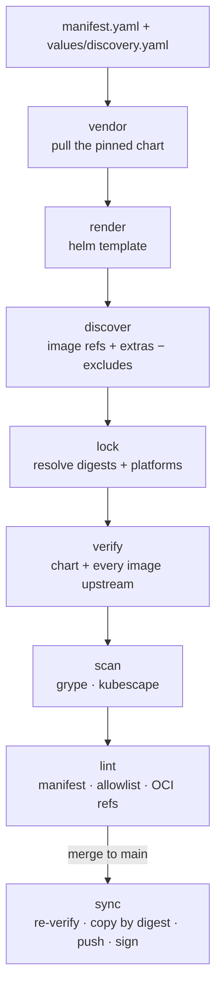

# The pipeline

The pipeline is the [`patchy mirror`](https://oss.bitwisemedia.uk/patchy/cli/patchy_mirror/) command group. Three verbs
do all the work, and each touches exactly one place:

| Verb       | Task                     | Writes to        | Purpose                                         |
| ---------- | ------------------------ | ---------------- | ----------------------------------------------- |
| `upgrade`  | `make update`            | the working tree | move pins forward and regenerate every fact     |
| `validate` | `make validate`          | nothing          | prove the commit is current, verified and clean |
| `sync`     | `make publish` (CI only) | the registry     | converge the registry onto the commit, signed   |

patchy never runs git. Branches, commits and PRs belong to the [workflows](automation.md).

## Regenerate

`upgrade` and the `regen` stage of `validate` run the same steps. `upgrade` writes the results, and `validate` compares
them with the commit.

1. **Vendor.** Pull the pinned chart (from an `oci://` registry or an `https://` helm index) and unpack it into
   `vendor/<chart>/`. The archive's sha256 is recorded in the lock.
2. **Render.** Run `helm template` with the discovery namespace, `kubeVersion` and values files, and write
   `rendered/manifests.yaml`.
3. **Discover.** Collect every image reference in the render. Add `images.extra` (with `{appVersion}` expanded from the
   vendored `Chart.yaml`) and the generated `images.extra.yaml`, then drop anything matching `images.exclude`. An empty
   set fails unless `images.allowEmpty` is set, which suits CRD-only charts.
4. **Lock.** Resolve each image to its digest and platform list, and compute its target path in each registry. The
   result is `images.lock.yaml`.

During `upgrade` only, two wall-clock steps run first: tracked tags are re-picked, and generated allowlists are rebuilt
after the scan.

## Verify

Upstream provenance is checked against the manifest's rules before anything is mirrored:

- `chart.verifyUpstream` covers the chart archive.
- `images.verifyUpstream` is a first-match-wins list of glob rules. **Every** locked image must match one.

The providers are `cosign-keyless` (a Fulcio certificate identity regex and OIDC issuer), `cosign-key` (a public key,
optionally with a non-default payload digest), and `none`. `none` is a documented gap: it is listed in every verify run,
never hidden. Rules can also name a `signatureRepository` for publishers that keep signatures apart from the artifact.
Each chart's page shows the rule every image matched.

## Scan

grype scans each locked image and kubescape scans the rendered configuration. The gates come from `mirror.yaml`, and a
chart can override them in its own `scan` block. See [Scanning & allowlists](scanning.md).

## Lint

The lint stage checks the manifest and each allowlist. Every allowlist entry needs a statement and an `expired_at`
within `allowlistMaxDays`. It also checks that the rendered output pulls only from the mirror: any `oci://` reference
outside it must be listed in `ociRefs.allow` with a reason.

## Publish

After merge, the publish workflow runs `patchy mirror validate --all --only verify` again on `main`, so nothing that got
around the PR gate is ever signed, and then `patchy mirror sync --all`. For each entry, `sync`:

1. Re-pulls the upstream chart archive and byte-compares it with the lock and the committed `vendor/` tree. If upstream
   changed a released version in place, the publish fails loudly.
2. Pushes the chart to `<registry>/<chartNamespace>/<name>:<version>`, unless that tag already exists. An existing tag
   is never replaced.
3. Copies every locked image **by digest** to `<registry>/<imageNamespace>/<source path>:<tag>`.
4. Signs everything it published that doesn't already carry a valid mirror signature.

Skipped steps count as successes, so a re-run after a partial failure just finishes the rest. `sync` always runs over
the whole store, so no changed-entry detection is needed.
