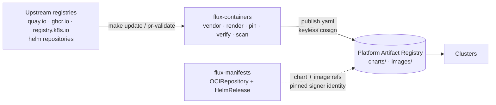

# Overview

flux-containers is the supply-chain mirror store for the patchy platform. Every helm chart the
[flux-manifests](https://github.com/bitwise-media-group/flux-manifests) stack deploys is mirrored here first, along with
every container image those charts run. Clusters pull charts and images only from the platform Artifact Registry, and
only when they carry this repository's signature. They never pull from a public registry.

For each chart, the mirror:

1. **Vendors** the pinned upstream chart, committed verbatim.
2. **Renders** it with `helm template` and commits the output.
3. **Discovers** every image the render references (plus the ones helm can't see) and pins each one to a digest.
4. **Verifies** the upstream provenance of the chart and every image against the publisher's cosign identity or key.
5. **Scans** the images with grype and the rendered configuration with kubescape. Accepted findings need an expiry.
6. **Publishes** the chart and images to the platform registry after merge, signed keylessly by the publish workflow.

The engine is the [`patchy mirror`](https://oss.bitwisemedia.uk/patchy/cli/patchy_mirror/) command group of the patchy
CLI, pinned in `mise.toml`. This repository holds the data it operates on and the workflows that drive it. The mise
tasks are thin forwarders.

## Where it sits



- **Upstream** is only contacted by this repository's tooling: on `make update`, in pr-validate, and by the publish
  workflow as it copies images.
- **The platform registry** is a single Artifact Registry repository created by the terraform artifact-store module.
  Charts live under `charts/` and images under `images/<original registry path>`.
- **flux-manifests** points its `OCIRepository` sources and image values at the registry, and requires the publish
  workflow's exact certificate identity. See [Consuming the mirror](../reference/consuming.md).

## Repository layout

```text
mirror.yaml                 pipeline-wide config: registry, signing identity, cooldown, scan gates
charts/<name>/
  manifest.yaml             INTENT — the only hand-edited file (pin, constraint, verify rules)
  values/discovery.yaml     INTENT — render values so image discovery is complete
  security/allowlist.yaml   INTENT — accepted CVEs (statement + expired_at, at most 90 days out)
  images.extra.yaml         GENERATED — machine-derived extra images (distribution manifests)
  vendor/<chart>/           FACT — the upstream chart, byte-identical
  rendered/manifests.yaml   FACT — helm template output
  images.lock.yaml          FACT — digest-resolved source → mirror-target image map
artifacts/<name>/           the same shape for non-chart OCI artifacts (manifest.yaml + lock.yaml)
tasks.toml                  the mise task surface (thin forwarders to patchy mirror)
docs/ · zensical.toml       this site
```

The split between intent and facts is the core rule. It's explained in
[Intent and facts](../concepts/intent-and-facts.md).

## Prerequisites

- **mise** (`brew install mise`). Every other tool is pinned: patchy, crane and yq in the root `mise.toml`, and grype,
  kubescape, helm, cosign and the linters via the shared [toolchain](https://oss.bitwisemedia.uk/toolchain/) mounted at
  `.mise/`.
- **jq**, which is deliberately unpinned because every runner and workstation already has one.
- **Network access** to the upstream registries, for `update` and `validate`.

Publishing needs the CI identity, so it never runs from a workstation.

## Next steps

- Clone the repository and learn the [daily workflow](daily-workflow.md).
- [Add a chart](adding-a-chart.md) to the mirror.
- Read [The pipeline](../concepts/pipeline.md) for what each stage proves.
